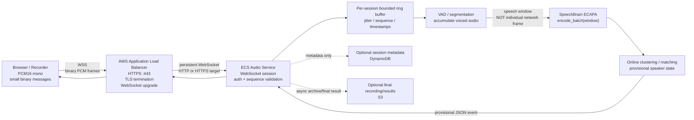
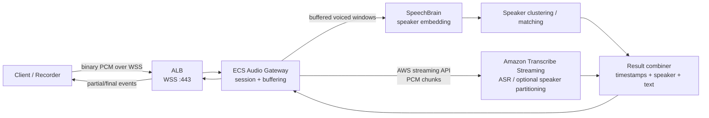

# ADR: Low-Latency SpeechBrain Streaming over AWS ALB and WebSockets

## Executive summary

**Status:** Proposed  
**Scope:** Architecture B — low-latency audio streaming using AWS and SpeechBrain  
**Decision:** Use **WSS → Application Load Balancer → ECS** as the default transport architecture, but treat SpeechBrain speaker inference as **buffered segment inference**, not as native frame-by-frame streaming inference.

### Executive conclusions

**Question: Can Architecture B send binary audio frames over TLS through an AWS ALB using WSS?**

**Yes.** AWS Application Load Balancer natively supports WebSockets over HTTP and HTTPS listeners. With an HTTPS listener, the client establishes `wss://...`; TLS terminates at the ALB, and after the HTTP/1.1 `Upgrade` handshake the connection becomes a persistent WebSocket connection between the client and the selected target through the ALB. RFC 6455 explicitly defines binary WebSocket data frames, and the browser WebSocket standard sends `ArrayBuffer`, `ArrayBufferView`, and `Blob` values as binary messages. citeturn18search0turn18search16turn18search2turn20search0

AWS states:

> “Application Load Balancers provide native support for WebSockets.” citeturn18search0

The important security qualification is that **WSS guarantees TLS on the client → ALB leg**. The ALB → ECS leg is encrypted only when the target group uses HTTPS; with an HTTP target group it is plaintext inside the VPC. AWS supports HTTPS target groups and establishes a second TLS connection to the target. citeturn19search0turn18search16

**Question: Does SpeechBrain support incremental/streaming speaker inference?**

**Not in the same sense as its streaming ASR implementation.** SpeechBrain does have genuine streaming infrastructure, including `StreamingASR`, streaming contexts, streaming feature wrappers, and a Conformer streaming recipe. However, the standard SpeechBrain speaker-recognition API based on `EncoderClassifier`/ECAPA-TDNN is documented as **utterance-level** and `encode_batch()` produces **one vector embedding for the waveform supplied to that call**. ECAPA's attentive statistics pooling explicitly uses statistics over the current utterance and, by default, global utterance context. citeturn21view0turn21view1turn16search1turn16search2

SpeechBrain's source says:

> “Encodes the input audio into a single vector embedding.” citeturn21view0

This does **not** mean SpeechBrain requires the entire recording or entire session before inference. `encode_batch()` accepts waveform tensors, so Architecture B can feed it shorter speech segments. What it does mean is that the current speaker model should not be treated as a stateful neural network that consumes each 50 ms network frame and incrementally updates an embedding while reusing hidden state. Each call is effectively a new segment-level embedding calculation. citeturn21view0turn21view1

Therefore:

> **Network streaming and model streaming are two different concerns.**

Architecture B should transport small frames continuously, buffer them into meaningful speech windows, run SpeechBrain on those windows, and publish provisional speaker results.

### Benchmark gate checklist

Before committing to CPU/GPU sizing or claiming a latency target:

- [ ] Measure **capture → server arrival → VAD decision → embedding → speaker decision → client receipt** independently.
- [ ] Report p50, p95 and p99 end-to-end latency, not only average model inference time.
- [ ] Measure real-time factor and whether processing lag grows during long sessions.
- [ ] Compare SpeechBrain windows such as `0.5 / 1.0 / 1.5 / 2.0 / 3.0 s` and several hop sizes against an offline baseline.
- [ ] Measure speaker verification/identification accuracy and diarization accuracy separately; include label-revision/churn rate for provisional results.
- [ ] Test clean speech, noise, reverberation, multiple microphones, speaker overlap, short utterances and silence.
- [ ] Test at increasing concurrency on the actual CPU and GPU instance families being considered.
- [ ] Measure RAM/GPU memory, utilization, model warm-up time and throughput per instance.
- [ ] Inject network jitter, disconnects, reconnects and slow clients; verify bounded memory and backpressure.
- [ ] Do not approve a “zero latency” requirement; define a measurable SLO against a precisely defined start event.

The suggested window values above are **benchmark candidates, not SpeechBrain requirements**. SpeechBrain does not document a universal minimum window length for ECAPA inference; optimal latency/accuracy must be measured for the actual audio domain. The ECAPA implementation's utterance-wide statistics are precisely why shortening windows is an accuracy/latency trade-off rather than a pure networking optimization. citeturn21view1turn21view3

## Concise answers and evidence

### Binary audio over WSS and ALB

The intended connection is:

```text
Client
  |
  | TLS
  | wss://audio.example.com/v1/audio
  | WebSocket binary messages
  v
AWS Application Load Balancer :443
  |
  | HTTP WebSocket         OR         HTTPS WebSocket
  | plaintext inside VPC              second TLS connection
  v
ECS task
```

AWS documents that an ALB can upgrade an HTTP/1.1 connection into `ws` or `wss`, and that the TCP connection to both the load balancer and target becomes a persistent WebSocket connection through the ALB. HTTPS listeners terminate the client TLS connection using the configured certificate. citeturn18search0turn18search16

RFC 6455 defines WebSocket opcode `0x2` as binary data. The WHATWG browser WebSocket standard explicitly states that `ArrayBuffer`, `ArrayBufferView` and `Blob` sent through `WebSocket.send()` use the binary frame opcode. Therefore raw PCM does **not** need Base64 encoding when using ALB + a normal WebSocket server. citeturn18search2turn20search0

This is materially different from **API Gateway WebSocket APIs**. AWS explicitly states that API Gateway currently rejects incoming binary WebSocket frames with close code `1003`; its documented workaround is Base64 text. API Gateway also imposes a 32 KiB maximum WebSocket frame size and 128 KiB message payload limit. citeturn15search3turn15search5

For continuous raw audio, that is a strong argument in favor of ALB + ECS.

### What WSS protects

With this configuration:

```text
Client --WSS/TLS--> ALB --HTTP--> ECS
```

the Internet-facing leg is encrypted, but the backend hop is HTTP.

With:

```text
Client --WSS/TLS--> ALB --HTTPS/TLS--> ECS
```

both network legs are encrypted. AWS documents that when an ALB target group uses HTTPS, the load balancer establishes TLS connections to targets. AWS also notes that ALB does not validate the target certificate in this mode; AWS relies on VPC packet-level protections for that backend path. citeturn19search0

If a requirement instead says **the application container itself must terminate the original client TLS session**, ALB TLS termination is the wrong topology. AWS recommends a Network Load Balancer TCP listener on port 443 for encrypted pass-through traffic. citeturn19search1turn19search3

That distinction should be explicit in a security review:

| Requirement | Appropriate design |
|---|---|
| TLS from Internet client to AWS ingress | ALB HTTPS/WSS |
| Encryption on both client→ALB and ALB→ECS | ALB HTTPS + HTTPS target group |
| Original TLS session must terminate in application | NLB TCP/TLS pass-through |
| HTTP path/host routing required | ALB |
| Raw L4 pass-through required | NLB |

AWS sources: [ALB listeners](https://docs.aws.amazon.com/elasticloadbalancing/latest/application/load-balancer-listeners.html), [HTTPS listeners](https://docs.aws.amazon.com/elasticloadbalancing/latest/application/create-https-listener.html), [ALB target groups](https://docs.aws.amazon.com/elasticloadbalancing/latest/application/load-balancer-target-groups.html), [NLB listeners](https://docs.aws.amazon.com/elasticloadbalancing/latest/network/load-balancer-listeners.html). citeturn18search0turn18search16turn19search0turn19search1

### What SpeechBrain actually streams

SpeechBrain must be discussed at the **model/API level**, not as one homogeneous library capability.

The current speaker interface, `EncoderClassifier`, is described in source as a ready-to-use class for:

> “utterance-level classification”

and its speaker-recognition example loads `speechbrain/spkrec-ecapa-voxceleb` and calls `encode_batch(signal)`. citeturn21view0

The method itself takes a tensor representing a waveform and returns a single embedding. It does **not** expose a persistent speaker-stream context analogous to SpeechBrain's streaming ASR context. citeturn21view0turn16search1

The ECAPA implementation gives an even stronger architectural reason not to pretend this is frame-level streaming. Its attentive statistics pooling computes mean and standard deviation over the temporal dimension and, with `global_context=True`, explicitly lets attention use:

> “global properties of the utterance.” citeturn21view1

By contrast, SpeechBrain's genuine streaming ASR stack explicitly defines `ASRStreamingContext` and describes the same context object being reused across subsequent calls. `StreamingASR` is described as a **“streaming-capable ASR model.”** citeturn16search1

SpeechBrain's Conformer streaming tutorial explains what actual neural streaming requires: limiting future context, remembering prior context and, during inference, processing outputs chunk by chunk while caching past hidden state. citeturn21view2

SpeechBrain therefore supports **streaming models**, but that fact cannot automatically be transferred to ECAPA speaker recognition.

A SpeechBrain collaborator made essentially the same distinction in a repository issue about embedding memory usage: the default path processes the waveform at once, while converting models to streaming can require manual model-specific adaptation and validation. citeturn21view3

Historically, SpeechBrain's AMI diarization maintainers also described that recipe as offline and based on spectral clustering. That issue dates from 2021, so it should be treated as historical evidence rather than a definitive statement about every current SpeechBrain component. citeturn16search0

The practical conclusion is:

| Capability | SpeechBrain status relevant to Architecture B |
|---|---|
| Accept a short waveform tensor | **Yes** |
| Create speaker embedding for that segment | **Yes** |
| Require entire meeting/session file | **No** |
| Stateful incremental ECAPA embedding API | **No documented stock API found** |
| Streaming feature utilities | **Yes** |
| Stateful streaming ASR APIs | **Yes** |
| Stock online speaker diarization equivalent to `StreamingASR` | **No documented equivalent found in the reviewed speaker APIs** |
| Rolling-window speaker inference | **Can be implemented by the application** |
| Online clustering/label reconciliation | **Application responsibility unless another component is introduced** |

Sources: [SpeechBrain `EncoderClassifier`](https://github.com/speechbrain/speechbrain/blob/develop/speechbrain/inference/classifiers.py), [ECAPA-TDNN](https://github.com/speechbrain/speechbrain/blob/develop/speechbrain/lobes/models/ECAPA_TDNN.py), [Streaming ASR implementation](https://github.com/speechbrain/speechbrain/blob/develop/speechbrain/inference/ASR.py), [Streaming feature wrapper](https://github.com/speechbrain/speechbrain/blob/develop/speechbrain/lobes/features.py), [SpeechBrain streaming Conformer tutorial](https://speechbrain.readthedocs.io/en/v1.0.3/tutorials/nn/conformer-streaming-asr.html). citeturn21view0turn21view1turn16search1turn16search2turn21view2

## Architecture B reference flow

### Recommended WSS path



The critical design rule is the separation between **transport frames** and **model inference windows**.

A 50–100 ms network message is useful because it provides low transport latency and bounded packet/message size. It is **not** automatically a suitable ECAPA speaker-recognition input. SpeechBrain's speaker embedding is computed over the complete waveform supplied to `encode_batch()`, including utterance-wide attentive statistics. citeturn21view0turn21view1

A sensible first implementation therefore looks like:

```text
50–100 ms transport frames
        ↓
bounded PCM ring buffer
        ↓
VAD / speech activity
        ↓
~0.5–3 s experimental inference windows
        ↓
SpeechBrain embedding
        ↓
online cluster / enrolled-speaker comparison
        ↓
provisional result
```

The `0.5–3 s` range is a proposed benchmark space, **not an official SpeechBrain specification**. It deliberately explores the latency/accuracy boundary.

### Optional Amazon Transcribe path

Amazon Transcribe Streaming is genuinely designed for continuous audio streaming. AWS supports bidirectional HTTP/2 or WebSocket streams in which audio is sent to Transcribe and results are streamed back to the application. citeturn15search4



This keeps one external session protocol while allowing the server to fan out audio internally.

Amazon Transcribe recommends streaming audio close to real time and, for PCM, recommends chunks between **50 and 200 ms**. Its PCM format is signed 16-bit little-endian; streaming also supports FLAC and Ogg Opus. citeturn15search2turn15search8

Those values are useful evidence for **transport chunking**, but they should not be misquoted as SpeechBrain's ECAPA inference-window requirement.

For 16 kHz mono PCM16, AWS's chunk-size formula gives approximately:

| Duration | PCM payload |
|---:|---:|
| 50 ms | 1,600 bytes |
| 100 ms | 3,200 bytes |
| 200 ms | 6,400 bytes |

The calculation follows AWS's documented `duration × sample-rate × 2 bytes` formula. citeturn15search2

For the SpeechBrain ECAPA pipeline, **16 kHz mono PCM16** is the cleanest initial wire format because the SpeechBrain classifier documentation expects 16 kHz input for this class of model, while Transcribe also directly accepts signed PCM16LE when the optional ASR path is enabled. citeturn21view0turn15search8

## Transport and security comparison

| Property | **ALB + ECS over WSS** | **API Gateway WebSocket** | **NLB + ECS** | **Amazon Transcribe Streaming** |
|---|---|---|---|---|
| Main role | General application WebSocket ingress | Managed WebSocket API/router | L4/TLS load balancing | Managed streaming ASR |
| Raw inbound binary WebSocket audio | **Yes** | **No — incoming binary frames rejected** | **Yes** | **Yes, through supported streaming protocol** |
| Browser connection | `wss://` | `wss://` | `wss://` when backend/application speaks WebSocket | WebSocket possible; SDK/HTTP2 also supported |
| TLS at AWS edge | HTTPS listener | Managed WSS endpoint | TLS listener, or TCP pass-through | Managed service endpoint |
| TLS to application container | Optional HTTPS target group | Depends on integration | Can terminate at NLB or pass through | N/A |
| HTTP path/host routing | **Yes** | Route model | No equivalent L7 routing with TCP pass-through | N/A |
| Binary encoding overhead | None beyond WebSocket framing | Base64 workaround required for inbound binary | None beyond chosen protocol | Native audio |
| Documented idle behavior relevant here | ALB default 60 s; configurable 1–4000 s | WebSocket idle timeout 600 s | Depends on NLB configuration/protocol | Managed streaming session semantics |
| Frame/message restrictions highlighted by docs | Normal WebSocket semantics | 32 KiB frame, 128 KiB message | L4 behavior | Audio-event API |
| Built-in application auth options | OIDC/Cognito, JWT-validation, mTLS; application auth also possible | API Gateway authorizer ecosystem | Mostly application/TLS level | IAM/SigV4 |
| Best fit for Architecture B | **Recommended** | Poor fit for raw PCM WebSocket ingress | Specialist option | Optional ASR branch |
| SpeechBrain execution | ECS | Backend required anyway | ECS | **No — Transcribe is a separate service** |

AWS explicitly says API Gateway WebSocket APIs do not currently support incoming binary frames and disconnect a client that sends one. That makes it a poor default for a service whose dominant traffic is binary PCM. citeturn15search3turn15search5

By contrast, ALB implements the standard WebSocket upgrade and AWS does not impose API Gateway's “text-only inbound” restriction. The WebSocket protocol itself supports binary frames. citeturn18search0turn18search2

### Recommended transport choice

For Architecture B:

```text
Route53
   ↓
ALB :443 / ACM
   ↓
HTTPS target group
   ↓
ECS audio-service
```

is the strongest default unless there is a specific requirement for TLS pass-through.

ALB gives the application WebSocket semantics, health-checked ECS targets, path/host routing, HTTPS termination, and AWS-native authentication capabilities without introducing an API Gateway binary limitation. AWS now supports listener-rule JWT validation in addition to OIDC/Cognito authentication options, and ALB also supports mTLS modes for certificate-based clients. citeturn18search1turn19search8turn19search18

NLB becomes preferable when the requirement is primarily L4 — for example, the application must receive the original encrypted TLS stream. AWS explicitly documents TCP port 443 as the pass-through choice for this case. citeturn19search1

## Operational implications for Architecture B

### Timeouts and heartbeat

The ALB connection idle timeout defaults to **60 seconds** and is configurable from **1 to 4000 seconds**. AWS defines this as inactivity where no data is sent or received. citeturn14search1

During active audio transmission this normally is not a problem because binary messages continuously contain data. Silence or paused capture is different.

A reasonable initial configuration is:

```text
ALB idle timeout:        120–300 s
Application heartbeat:   20–30 s while no audio is sent
Client failure timeout:  several missed heartbeats
```

Those values are engineering starting points rather than AWS requirements.

One subtle browser issue is that WebSocket protocol Ping/Pong control frames are not exposed by the standard browser WebSocket API. The WHATWG specification explicitly notes that ping/pong exists at protocol level but is not exposed to JavaScript. A browser application therefore commonly uses an application-level text heartbeat such as `{"type":"ping"}` when no audio is flowing. citeturn20search0

### Buffering

Do **not** implement:

```text
100 ms PCM
   ↓
SpeechBrain encode_batch()
   ↓
100 ms PCM
   ↓
SpeechBrain encode_batch()
```

That confuses network packetization with speaker-model context.

Instead:

```text
100 ms
100 ms
100 ms
100 ms
100 ms
...
   ↓
ring buffer + VAD
   ↓
sufficient voiced window
   ↓
encode_batch(window)
```

SpeechBrain's ECAPA pooling computes statistics across the input time dimension and uses global utterance information by default, so extremely short embeddings may lose discriminative speaker information even though the API technically accepts a short tensor. citeturn21view1

The application should benchmark at least two strategies:

**Sliding window**

```text
window = 1.5 s
hop    = 0.5 s

[-----------]
    [-----------]
        [-----------]
```

This gives frequent updates but repeatedly computes embeddings over overlapping samples.

**VAD-triggered segments**

```text
silence | speech speech speech | silence
             ↓
       speaker embedding
```

This tends to align embeddings better with actual utterances, but result timing varies with speech patterns.

Neither set of timing parameters is prescribed by SpeechBrain.

### Reconnection and session recovery

A WebSocket is a long-lived connection to one selected target through the ALB. When the ECS task disappears, is terminated during deployment, or the network fails, that individual connection cannot simply continue on another target; the client establishes a new WebSocket connection. AWS describes the upgraded connection as persistent between the client and target through the load balancer. citeturn18search0

Therefore application protocol state should contain at minimum:

```json
{
  "session_id": "019af...",
  "connection_epoch": 3,
  "seq": 12341,
  "captured_at_ms": 1793029456123
}
```

`seq` is not needed to repair TCP ordering inside one healthy WebSocket connection. It is valuable for:

- gap detection;
- duplicate detection after reconnect;
- replay;
- debugging;
- measuring client-to-server delay;
- safely resuming a logical session on another ECS task.

A practical reconnect protocol is:

```text
Client                                 Server

CONNECT ----------------------------->

start(session_id)
------------------------------------->

audio(seq=100)
audio(seq=101)
audio(seq=102)
------------------------------------->

                         ack(seq=102)
<-------------------------------------

         connection lost

RECONNECT --------------------------->

resume(
  session_id,
  last_server_ack=102
)
------------------------------------->

audio(seq=103)
audio(seq=104)
------------------------------------->
```

For stronger recovery, the client can retain a short rolling replay buffer and resend samples newer than the last acknowledged sequence. The duration of that buffer is a product choice and should be benchmarked rather than hard-coded architecturally.

### Backpressure

The browser WebSocket interface exposes `bufferedAmount`, defined as application bytes queued by `send()` but not yet transmitted. The WHATWG standard even demonstrates using it to avoid sending faster than the network can accept data. citeturn20search0

That should be part of the client implementation.

Server-side, each session should likewise have a **bounded queue**. Never allow:

```text
network input > inference capacity
       ↓
unbounded Python queue
       ↓
eventual OOM
```

Use:

```text
WebSocket
    ↓
small bounded ingestion queue
    ↓
ring buffer
    ↓
VAD / inference scheduler

queue too deep?
    ├── emit "slow_down"
    ├── reject additional work according to policy
    └── close/reconnect if the service cannot recover
```

The useful operational metric is not simply CPU utilization. It is whether:

```text
audio_received_timestamp
-
audio_processed_timestamp
```

keeps increasing.

Call it, for example:

```text
audio_processing_lag_seconds
```

When that value continuously grows, the worker is no longer operating in real time even if individual model invocations still look fast.

### Authentication and authorization

For native/mobile/service clients, short-lived JWTs in the WebSocket upgrade request are straightforward when the WebSocket library supports custom headers. ALB itself can now perform JWT validation on HTTPS listener rules. citeturn18search1turn18search9

For browser JavaScript there is an important constraint: the standard `WebSocket` constructor accepts only a URL and optional subprotocols; it does not expose a generic arbitrary-header argument. citeturn20search0

For browser clients, preferable approaches are therefore:

```text
HTTPS login
   ↓
Secure session established
   ↓
WSS handshake
   ↓
server validates session + Origin
```

or a short-lived one-time connection credential.

Avoid long-lived bearer tokens in WebSocket query strings. ALB request logging includes request paths, which creates unnecessary credential-exposure risk if credentials are embedded in URLs. citeturn14search12

For machine/device scenarios where certificate identity is desirable, ALB also supports mutual TLS verification and passthrough modes. citeturn19search18turn19search6

### Security boundary

The ECS security group should accept the application port **only from the ALB security group**, not from the Internet or the entire VPC. AWS explicitly recommends restricting targets so they receive traffic only from the ALB in its authentication guidance. citeturn19search8

For sensitive audio and speaker embeddings, the recommended path is:

```text
Internet
   |
   | WSS / TLS
   v
ALB
   |
   | HTTPS / TLS
   v
ECS
```

rather than:

```text
Internet
   |
   | WSS / TLS
   v
ALB
   |
   | HTTP
   v
ECS
```

The second architecture may still be acceptable under a particular threat model, but it should be an explicit security decision rather than an accidental Terraform default. AWS documents HTTPS target groups specifically for encrypted ALB-to-target traffic. citeturn19search0

## Recommended implementation pattern and code

### Application protocol

Use one WebSocket connection per active audio session.

Start with a text control message:

```json
{
  "type": "start",
  "protocol_version": 1,
  "session_id": "019af2f4-6a21-7000-9bb7-abc123",
  "audio": {
    "encoding": "pcm_s16le",
    "sample_rate_hz": 16000,
    "channels": 1
  }
}
```

Then use **binary WebSocket messages** for audio.

A simple application-level binary envelope can be:

```text
byte 0..3    uint32   sequence number, big endian
byte 4..11   uint64   capture timestamp milliseconds, big endian
byte 12..N            PCM16LE audio payload
```

The transport header and PCM sample byte order do not need to match; the envelope can use network byte order while the audio payload remains signed 16-bit little-endian.

At 16 kHz mono PCM16:

```text
100 ms frame
= 0.1 × 16,000 × 2
= 3,200 bytes PCM
```

This is comfortably small for WebSocket transport and follows the same PCM representation accepted by Amazon Transcribe Streaming. citeturn15search2turn15search8

A good initial transport experiment is **50–100 ms per message**. AWS recommends 50–200 ms for Transcribe streaming; the narrower 50–100 ms recommendation here is an Architecture B starting point intended to reduce transport contribution to latency, not an AWS or SpeechBrain mandate. citeturn15search2

### Browser-side example

The browser standard permits `ArrayBuffer` to be sent as a WebSocket binary message and exposes `bufferedAmount` for monitoring queued data. citeturn20search0

```javascript
const socket = new WebSocket("wss://audio.example.com/v1/audio");
socket.binaryType = "arraybuffer";

let sequence = 0;

socket.addEventListener("open", () => {
  socket.send(JSON.stringify({
    type: "start",
    protocol_version: 1,
    session_id: crypto.randomUUID(),
    audio: {
      encoding: "pcm_s16le",
      sample_rate_hz: 16000,
      channels: 1
    }
  }));
});

/**
 * pcm16le must contain already-encoded signed 16-bit little-endian PCM.
 */
function sendAudioFrame(pcm16le, capturedAtMs) {
  if (socket.readyState !== WebSocket.OPEN) {
    return false;
  }

  // Example policy, not a protocol requirement:
  // stop feeding an already-congested socket.
  const MAX_BUFFERED_BYTES = 512 * 1024;

  if (socket.bufferedAmount > MAX_BUFFERED_BYTES) {
    console.warn("Audio WebSocket is backpressured");
    return false;
  }

  const headerSize = 12;
  const out = new Uint8Array(headerSize + pcm16le.byteLength);
  const header = new DataView(out.buffer);

  // Application envelope in network byte order.
  header.setUint32(0, sequence++, false);
  header.setBigUint64(4, BigInt(capturedAtMs), false);

  out.set(new Uint8Array(pcm16le), headerSize);

  // ArrayBufferView -> binary WebSocket message.
  socket.send(out);

  return true;
}

socket.addEventListener("message", (event) => {
  if (typeof event.data === "string") {
    const msg = JSON.parse(event.data);

    if (msg.type === "speaker_update") {
      console.log(
        msg.speaker_id,
        msg.start_ms,
        msg.end_ms,
        msg.confidence,
        msg.is_final
      );
    }
  }
});

socket.addEventListener("close", () => {
  // Reconnect with jitter/backoff and send a "resume" control message.
});
```

For production code, capture/resampling should run outside timing-sensitive UI logic, typically through a dedicated audio-processing path such as an `AudioWorklet`. The exact client capture implementation is separate from the WSS protocol decision.

### Server-side pseudocode

The core rule is visible here: **receive network frames continuously, but call SpeechBrain on buffered speech windows rather than on each frame**.

```python
async def websocket_audio_session(ws):
    principal = await authenticate_upgrade(ws)
    session = await load_or_create_session(principal)

    await ws.accept(subprotocol="audio.v1")

    try:
        while True:
            message = await ws.receive()

            if message.is_text:
                command = parse_control_message(message.text)

                if command.type == "resume":
                    await session.resume(command)

                elif command.type == "ping":
                    await ws.send_json({"type": "pong"})

                continue

            if not message.is_binary:
                continue

            seq, captured_at_ms, pcm16le = parse_audio_frame(message.bytes)

            # Detect replay, duplicates or gaps.
            session.validate_sequence(seq)

            # Bounded memory; never an unbounded asyncio.Queue.
            if not session.audio_buffer.try_append(
                seq=seq,
                captured_at_ms=captured_at_ms,
                pcm=pcm16le,
            ):
                await ws.send_json({
                    "type": "slow_down",
                    "reason": "server_audio_buffer_full",
                })
                continue

            # VAD and segmentation run incrementally around the buffer.
            session.vad.consume(pcm16le)

            while session.has_inference_window():
                waveform = session.take_speech_window()

                # Important:
                # This is segment-level inference.
                # It is NOT one encode_batch() call per network frame.
                embedding = speaker_model.encode_batch(
                    waveform,
                    normalize=True,
                )

                result = session.cluster_or_match(embedding)

                await ws.send_json({
                    "type": "speaker_update",
                    "session_id": session.id,
                    "speaker_id": result.speaker_id,
                    "start_ms": result.start_ms,
                    "end_ms": result.end_ms,
                    "confidence": result.confidence,
                    "is_final": False,
                })

            await session.ack(seq)

    except WebSocketDisconnected:
        await persist_resume_metadata(
            session_id=session.id,
            last_acked_seq=session.last_acked_seq,
        )
```

The SpeechBrain call in this pseudocode matches the model's documented segment-level `encode_batch()` behavior. The surrounding buffering, VAD, sequence management and online speaker-state logic are application responsibilities. citeturn21view0turn21view1

### Result semantics

Do not publish:

```json
{
  "speaker_id": "alice",
  "final": true
}
```

as soon as the first short segment is embedded.

Use provisional semantics:

```json
{
  "type": "speaker_update",
  "speaker_id": "speaker_2",
  "confidence": 0.82,
  "is_final": false,
  "revision": 4
}
```

and perform final reconciliation at segment/session boundaries.

This is especially important for diarization because online information is incomplete by definition. SpeechBrain's documented diarization history and clustering-oriented recipes reinforce that its standard diarization workflow should not simply be assumed to have online semantics. citeturn16search0

## Benchmark plan and ADR decision

### What to benchmark

The most important experiment is **not** “how long does `encode_batch()` take once?”

It is:

```text
Does the complete service remain faster than real time
while producing acceptable speaker accuracy
at expected concurrency?
```

Capture these timestamps for every inference result:

```text
t0 = client audio captured
t1 = WebSocket message received by ECS
t2 = speech window declared ready
t3 = SpeechBrain inference started
t4 = SpeechBrain inference finished
t5 = clustering/matching finished
t6 = response sent
t7 = client received response
```

Then calculate:

```text
transport_in     = t1 - t0
buffer_wait      = t2 - t1
queue_wait       = t3 - t2
model_latency    = t4 - t3
decision_latency = t5 - t4
transport_out    = t7 - t6

end_to_end       = t7 - t0
```

This makes architectural latency visible. A model that runs in 30 ms can still produce a 1.5-second user-visible result if the system waits 1.4 seconds to accumulate enough speech.

### Model-quality benchmark

For speaker verification or identification, compare each low-latency setting against the offline reference model rather than benchmarking only compute time. SpeechBrain's ECAPA embedding is derived from statistics over the supplied utterance, so changing input duration changes the information available to the model. citeturn21view1

A useful experimental matrix is:

| Window | Hop | Expected engineering characteristic |
|---:|---:|---|
| 0.5 s | 0.25 s | Lowest waiting time; likely hardest accuracy regime |
| 1.0 s | 0.25 s | Frequent result updates, considerable repeated compute |
| 1.5 s | 0.5 s | Reasonable first compromise to test |
| 2.0 s | 0.5 s | More speaker evidence, higher intrinsic latency |
| 3.0 s | 1.0 s | Useful comparison against longer offline-style segmentation |

These are **test configurations proposed by this ADR**, not SpeechBrain-certified operating points.

For diarization, measure at least:

```text
DER / JER
speaker confusion
false alarm
missed speech
speaker-label revision rate
time-to-stable-speaker-label
```

For enrolled-speaker identification/verification, measure:

```text
EER or FAR/FRR at chosen thresholds
unknown-speaker rejection
top-1 correctness where applicable
short-utterance degradation
confidence calibration
```

And for system performance:

```text
p50 / p95 / p99 end-to-end latency
real-time factor
audio_processing_lag_seconds
sessions per worker
CPU utilization
GPU utilization
GPU/RAM footprint
ingestion queue depth
WebSocket bufferedAmount
reconnect rate
dropped/replayed frame count
cost per concurrent session
cost per processed audio hour
```

### Concurrency benchmark

Do not derive fleet size from model reputation or instance size.

Run the same test on the actual candidate compute targets:

```text
1 concurrent session
2
5
10
20
...
until p95 latency or processing lag violates the SLO
```

For each level, sustain the test long enough to determine whether backlog stays flat. A system can appear healthy for a 30-second test while processing at a real-time factor slightly above `1.0`, only to accumulate minutes of lag in a long meeting.

Test CPU first if it meets the product SLO. Move to GPU-backed ECS/EC2 because benchmark data demonstrates a need, not because SpeechBrain happens to support CUDA.

### Architecture decision

The research supports **Architecture B**, with one important correction to how it should be described.

Do **not** describe it as:

```text
WebSocket frames
    ↓
SpeechBrain streaming speaker model
```

unless a genuinely streaming speaker model is implemented and validated.

Describe it as:

```text
WSS low-latency transport
    ↓
bounded incremental audio ingestion
    ↓
VAD / segmentation
    ↓
short rolling speech windows
    ↓
SpeechBrain segment-level embeddings
    ↓
online clustering / matching
    ↓
provisional results
```

That wording accurately reflects both AWS's transport capabilities and SpeechBrain's current speaker inference architecture. AWS ALB is a technically appropriate component for carrying binary WebSocket audio, while SpeechBrain ECAPA provides segment embeddings rather than a documented stateful incremental speaker-inference interface. citeturn18search0turn20search0turn21view0turn21view1

The resulting recommended topology is therefore:

```text
                         ┌──────────────────────────┐
                         │ Optional Amazon          │
                         │ Transcribe Streaming     │
                         │ transcription / ASR      │
                         └───────────▲──────────────┘
                                     │ PCM stream
                                     │
Client ── WSS/TLS ──> ALB ── TLS ──> ECS Audio Service
                                     │
                                     ├── bounded ring buffer
                                     │
                                     ├── VAD / segmentation
                                     │
                                     ├── SpeechBrain ECAPA
                                     │      segment embedding
                                     │
                                     ├── online speaker state
                                     │
                                     └── provisional result
                                              │
Client <── WSS/TLS ─── ALB <──────────────────┘
```

This architecture removes S3, SQS, Lambda and multi-stage orchestration from the **interactive path**. Storage and asynchronous finalization may still exist outside that path, but they do not determine the time to a live speaker result.

Most importantly, it makes the latency budget honest:

```text
network frame latency
+ speech context accumulation
+ VAD/segmentation delay
+ SpeechBrain inference
+ clustering/matching
+ network response
= observable user latency
```

There is no “zero latency” point in this pipeline. The engineering goal is instead to minimize and measure each term while keeping speaker accuracy acceptable.

### Primary source index

**AWS**

- [Application Load Balancer listeners and WebSocket support](https://docs.aws.amazon.com/elasticloadbalancing/latest/application/load-balancer-listeners.html) — AWS documents native `ws`/`wss` support and persistent upgraded connections. citeturn18search0
- [Create an HTTPS listener](https://docs.aws.amazon.com/elasticloadbalancing/latest/application/create-https-listener.html) — TLS termination behavior for ALB. citeturn18search16
- [ALB connection attributes](https://docs.aws.amazon.com/elasticloadbalancing/latest/application/edit-load-balancer-attributes.html) — 60-second default idle timeout and configurable range. citeturn14search1
- [ALB target groups](https://docs.aws.amazon.com/elasticloadbalancing/latest/application/load-balancer-target-groups.html) — HTTPS target connections and certificate behavior. citeturn19search0
- [ALB JWT verification](https://docs.aws.amazon.com/elasticloadbalancing/latest/application/listener-verify-jwt.html) — HTTPS listener JWT validation. citeturn18search1
- [ALB user authentication](https://docs.aws.amazon.com/elasticloadbalancing/latest/application/listener-authenticate-users.html) — OIDC and Cognito authentication. citeturn19search8
- [ALB mutual TLS](https://docs.aws.amazon.com/elasticloadbalancing/latest/application/mutual-authentication.html) — client-certificate options. citeturn19search6
- [Network Load Balancer listeners](https://docs.aws.amazon.com/elasticloadbalancing/latest/network/load-balancer-listeners.html) — TLS termination and TCP pass-through alternatives. citeturn19search1
- [API Gateway binary WebSocket media](https://docs.aws.amazon.com/apigateway/latest/developerguide/websocket-api-develop-binary-media-types.html) — incoming binary-frame limitation. citeturn15search3
- [Amazon Transcribe streaming](https://docs.aws.amazon.com/transcribe/latest/dg/streaming.html) — recommended PCM streaming practices and 50–200 ms chunks. citeturn15search2
- [StartStreamTranscription](https://docs.aws.amazon.com/transcribe/latest/APIReference/API_streaming_StartStreamTranscription.html) — bidirectional HTTP/2/WebSocket streaming API. citeturn15search4

**SpeechBrain**

- [`EncoderClassifier` source](https://github.com/speechbrain/speechbrain/blob/develop/speechbrain/inference/classifiers.py) — utterance-level classification and segment embedding API. citeturn21view0
- [`ECAPA_TDNN.py`](https://github.com/speechbrain/speechbrain/blob/develop/speechbrain/lobes/models/ECAPA_TDNN.py) — attentive statistics pooling and global utterance context. citeturn21view1
- [`StreamingASR` source](https://github.com/speechbrain/speechbrain/blob/develop/speechbrain/inference/ASR.py) — explicit stateful streaming context, demonstrating what genuine SpeechBrain streaming looks like. citeturn16search1
- [`StreamingFeatureWrapper`](https://github.com/speechbrain/speechbrain/blob/develop/speechbrain/lobes/features.py) — reusable feature-extraction streaming context. citeturn16search2
- [SpeechBrain streaming Conformer tutorial](https://speechbrain.readthedocs.io/en/v1.0.3/tutorials/nn/conformer-streaming-asr.html) — architectural requirements for actual streaming models. citeturn21view2
- [SpeechBrain issue on embedding memory/streaming adaptation](https://github.com/speechbrain/speechbrain/issues/1825) — collaborator explanation that streaming adaptation is model-specific. citeturn21view3
- [Historical AMI diarization discussion](https://github.com/speechbrain/speechbrain/issues/771) — SpeechBrain collaborator describing that diarization recipe as offline/spectral-clustering based. citeturn16search0

**Protocol standards**

- [RFC 6455 — The WebSocket Protocol](https://www.rfc-editor.org/rfc/rfc6455) — defines binary WebSocket data frames. citeturn18search2
- [WHATWG WebSockets Standard](https://websockets.spec.whatwg.org/) — browser binary `send()`, `ArrayBuffer`, `bufferedAmount`, and browser WebSocket API behavior. citeturn20search0