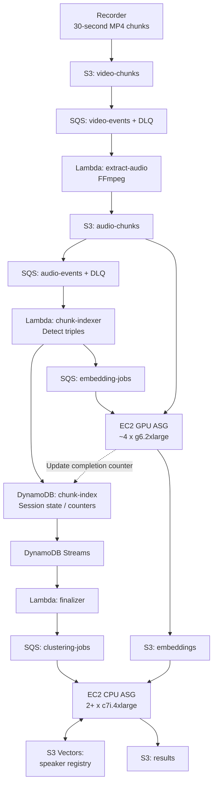
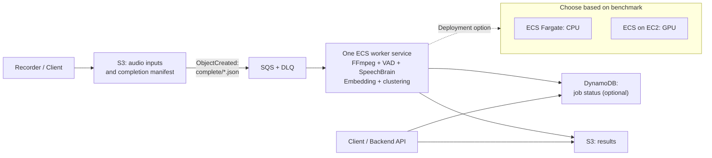
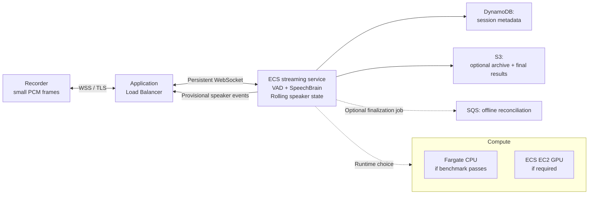

# ADR-001: SpeechBrain Audio Service — AWS Architecture Review

**Decision:** Prefer Architecture A for the initial release. Adopt Architecture B only if live speaker results are a confirmed product requirement. Reject the original architecture as the starting design.

---

## 1. Executive Summary

We are designing an AWS-hosted audio processing service powered by **SpeechBrain**, primarily for speaker embeddings, diarization, and potentially speaker identification.

Three approaches are considered:

- **Original architecture:** Multi-stage S3/SQS/Lambda/DynamoDB pipeline with dedicated GPU and CPU EC2 fleets.
- **Architecture A — Simple asynchronous processing:** S3 + SQS + one SpeechBrain worker service.
- **Architecture B — Low-latency streaming:** WebSocket + Application Load Balancer + continuously running SpeechBrain inference service.

**Recommendation:** Start with **Architecture A**, provided the business accepts asynchronous results. It has fewer failure modes, simpler deployment, and a cost model that can follow actual demand.

Choose **Architecture B** only if the product requires speaker information while the person is still speaking.

**“Zero latency” is not a valid requirement.** The team must agree on a measurable latency SLO, including precisely when the clock starts and what constitutes a result.

The original architecture is not currently deployed. This is a design review, not a migration proposal.

## 2. Architecture Diagrams

### Original — Proposed Multi-Stage Architecture

**Assessment:** Technically possible, but unnecessarily distributed for an unproven workload. It also fails to satisfy a genuine low-latency requirement.

### Architecture A — Recommended Initial Design

**How it works:**

1. The client uploads the recording or its constituent chunks to S3.
2. When all uploads are complete, the client writes `complete/{session_id}.json`, listing the expected audio objects.
3. An S3 notification sends a single job to SQS.
4. One worker executes the complete SpeechBrain pipeline: decoding, voice activity detection, speech segmentation, embeddings, clustering, and optional identity matching.
5. The worker writes a versioned result to S3 and updates job status if an API needs polling.

There is **one processing queue, one worker implementation, and one result format**.

The worker can run on Fargate **only if CPU inference meets the benchmark**. GPU execution requires a different compute option, such as ECS on GPU-backed EC2 instances.

### Architecture B — Genuine Low-Latency Streaming

**How it works:**

1. The recorder sends small audio frames over an authenticated WebSocket connection.
2. The service maintains rolling session state and performs VAD and SpeechBrain inference on speech segments.
3. It returns **provisional** speaker events over the same connection.
4. At session completion, it optionally reconciles speaker labels and writes final results.

The critical path is **client → ALB → inference → client**.

S3, SQS, and session-wide clustering are not allowed to block provisional results.

---

## 3. Architecture Comparison

| Criterion | Original architecture | Architecture A — Async | Architecture B — Streaming |
|---|---|---|---|
| Primary purpose | Chunk-based distributed processing | Reliable asynchronous audio analysis | Live speaker events |
| Audio transport | 30-second MP4 objects through S3 | S3 uploads plus completion manifest | Small audio frames over WSS |
| SpeechBrain runtime | Dedicated GPU embedding fleet and separate CPU clustering fleet | One pipeline inside one worker | Long-running, model-loaded streaming service |
| AWS services | Multiple S3 areas, 4 SQS queues, multiple Lambdas, DynamoDB Streams, 2 EC2 fleets, S3 Vectors | S3, SQS, ECS, optional DynamoDB | ALB, ECS, optional DynamoDB/S3 |
| Earliest useful result | At least one 30-second chunk; triple-based processing can require substantially more | After upload completion and processing | After sufficient voiced audio and inference |
| Final speaker labels | After session ends and all embedding jobs complete | After the session job completes | After end-of-session reconciliation |
| “Zero latency” | Impossible | Impossible | Impossible |
| CPU/GPU support | GPU EC2 | Fargate CPU or ECS EC2 GPU | Fargate CPU or ECS EC2 GPU |
| Failure recovery | Retries across many independently failing stages | Retry one idempotent session job | Connection recovery plus optional finalization |
| Ordering | Chunk ordering must be reconstructed | Explicit manifest defines expected inputs | Frame sequence numbers and timestamps |
| Duplicate handling | Required at every queue, stream, and state update | Required at job boundary | Required for reconnects and repeated frames |
| Scaling signal | Queue depth, GPU utilization, CPU utilization, session state | SQS backlog per running task | Active sessions, inference utilization, processing lag |
| Idle cost | Potentially very high if EC2 fleets remain running | Low if workers scale down | Nonzero: warm serving capacity and ALB |
| Operational complexity | **High** | **Low** | **Medium** |
| Speaker diarization | Risky if embeddings are produced from arbitrary mixed-speaker triples | Segment speech first, then embed and cluster | Incremental diarization with possible label revisions |
| Cross-session identification | S3 Vectors registry | Add only if needed | Add only if needed |
| Best fit | Large, proven workloads with independently scaling stages | MVP, uploads, asynchronous processing | Live meetings, calls, interactive products |
| Recommendation | **Reject as initial design** | **Recommended default** | **Use for confirmed live requirements** |

## 4. Critical Review of the Original Architecture

The biggest problem is not the number of AWS icons. It is the absence of a demonstrated need for the complexity.

| Severity | Finding | Why it matters | Recommended correction |
|---|---|---|---|
| **Critical** | **30-second chunks contradict “zero latency.”** | A chunk cannot be processed before it exists and is uploaded. The architecture starts with a built-in buffering delay. | Use Architecture B if live feedback is required. |
| **Critical** | **Three adjacent chunks are not necessarily one speaker.** | A 90-second window may contain several speakers. A single embedding over mixed speech can compromise diarization and matching. | Perform VAD and speaker-homogeneous segmentation before generating SpeechBrain embeddings. |
| **High** | **Four GPU instances and two large CPU instances are assumed before benchmarking.** | This may create thousands of dollars in monthly compute cost without evidence of necessary throughput. | Benchmark one CPU worker, then one GPU worker, before selecting fleet size. |
| **High** | **Excessive orchestration for one logical job.** | Multiple queues, Lambdas, intermediate objects, and fleets multiply deployment and failure states. | Keep the processing pipeline in one worker until independent scaling is justified. |
| **High** | **Finalization depends on distributed counters.** | Retries, duplicate events, failed chunks, and out-of-order arrivals can make “all embedded” difficult to establish correctly. | Use an explicit session manifest and idempotent job state transitions. |
| **High** | **The design assumes event order that AWS does not guarantee.** | S3 notifications can arrive more than once and out of order. SQS standard queues are also at-least-once. | Idempotency keys, conditional writes, and explicit input manifests. |
| **High** | **Session-end clustering is incompatible with live final results.** | Final speaker identities cannot be available during the session if the decisive clustering step waits until it ends. | Distinguish provisional live labels from final labels. |
| **Medium** | **Repeated reads of overlapping audio.** | Every triple may fetch three chunks already read by adjacent jobs. This adds I/O and duplicate computation. | Process a session sequentially or maintain a rolling buffer. |
| **Medium** | **S3 Vectors is introduced without a registry-scale requirement.** | Approximate nearest-neighbor search is useful, but it does not automatically solve speaker identification or threshold calibration. | Start with local/session-level clustering. Add a registry after measuring its size and query needs. |
| **Medium** | **Multiple independent fleets complicate deployment.** | Model versions, rollbacks, draining, GPU capacity, and intermediate format compatibility must all be coordinated. | Package the initial SpeechBrain pipeline as one versioned container. |
| **Unverified** | **Security and observability controls are not visible.** | The diagram does not demonstrate IAM boundaries, encryption, retention, tracing, or auditability. | Specify these explicitly before production; absence from the drawing is not proof they were omitted. |

### The SpeechBrain-specific design issue

SpeechBrain is a machine-learning toolkit, not a managed AWS diarization service.

The proposed implementation must explicitly define:

- **VAD:** Which parts of the recording contain speech?
- **Segmentation:** Which speech windows are suitable for embedding extraction?
- **Speaker embeddings:** SpeechBrain ECAPA-TDNN or another pinned model.
- **Diarization:** Which anonymous speaker spoke at each time interval?
- **Identification:** Does a speaker match an enrolled identity?
- **Reconciliation:** How are provisional or fragmented labels merged?

**Speaker diarization and speaker identification are different requirements.**

Diarization can produce `speaker_1` and `speaker_2` without knowing who those people are.

Identification requires enrollment data, calibrated similarity thresholds, an unknown-speaker outcome, and appropriate privacy controls.

A single embedding generated from an arbitrary 90-second recording segment is not a substitute for speaker-aware segmentation.

SpeechBrain reference: [Official speaker recognition recipes](https://github.com/speechbrain/speechbrain/tree/develop/recipes/VoxCeleb/SpeakerRec).

## 5. Cost Analysis

### Original architecture: compute alone

**Illustrative assumptions:**

- AWS Region: `us-east-1`
- Linux, On-Demand EC2
- 730 hours per month
- 4 × `g6.2xlarge` GPU instances
- 2 × `c7i.4xlarge` CPU instances
- All six instances run continuously
- Approximate hourly prices from October 2026 public price snapshots; verify against AWS pricing before making a financial commitment

| Resource | Count | Approx. USD/hour each | Approx. USD/month |
|---|---:|---:|---:|
| `g6.2xlarge` | 4 | $0.9776 | $2,855 |
| `c7i.4xlarge` | 2 | $0.7140 | $1,042 |
| **Total EC2 compute** | **6** | **$5.3384 combined** | **$3,897** |

**Approximately $46,764 per year in EC2 compute if kept running continuously.**

This is **not** the complete AWS bill. It excludes EBS, S3, SQS, DynamoDB, S3 Vectors, CloudWatch, data transfer, NAT gateways, load balancers, and any support or licensing charges.

The original diagram specifies Auto Scaling Groups, so continuous operation is **a cost scenario, not proof of the actual minimum capacity**. If the fleets scale down, compute charges decrease. GPU cold-start time and the ability to meet the desired latency SLO must then be considered.

### Cost comparison by design

| Cost driver | Original | Architecture A | Architecture B |
|---|---|---|---|
| Idle compute | Up to ~$3,897/month under the 24/7 six-instance scenario | Potentially near zero worker compute when scaled to zero; not zero if a minimum worker is retained | Always-on serving capacity is normally required |
| GPU requirement | Four instances assumed | Zero if CPU benchmark passes; GPU EC2 otherwise | Zero if CPU benchmark passes; otherwise warm GPU capacity |
| Load balancer | Not central to processing | Not required for S3/SQS worker | Required for the proposed WSS ingress |
| Queue charges | Four queues plus DLQs | One queue plus DLQ | None in live path; optional finalization queue |
| S3 operations | Multiple intermediate writes and repeated reads | Input and final-result objects | Optional archive and final-result objects |
| DynamoDB | Chunk index, counters, session state, streams | Optional job metadata | Optional session metadata |
| NAT/networking | Depends on deployment | Can be significant relative to a tiny workload | Additional baseline networking cost |
| Cost predictability | Difficult without stage-by-stage utilization | Primarily driven by processed audio and worker time | Driven by peak concurrent sessions and warm capacity |

For perspective, **one continuously running `g6.2xlarge` is approximately $714/month in EC2 compute alone** at the illustrative hourly rate above.

That does not mean Architecture B costs only $714/month. High availability, concurrent-session capacity, ALB charges, storage, and networking can increase the total.

### Cost formulas to use in the AWS Pricing Calculator

**Original:**

`monthly_cost ≈ GPU_instance_hours × GPU_rate + CPU_instance_hours × CPU_rate + storage + requests + networking`

**Architecture A:**

`monthly_cost ≈ processing_task_hours × task_rate + S3 + SQS + optional DynamoDB + networking`

**Architecture B:**

`monthly_cost ≈ provisioned_serving_capacity_hours + ALB_hours + ALB_LCUs + storage + networking`

For GPU-backed streaming, the most important variable is **how many simultaneous sessions one GPU can serve at the required latency**.

Do not select instance counts until that number is measured.

Pricing references:

- [AWS EC2 On-Demand pricing](https://aws.amazon.com/ec2/pricing/on-demand/)
- [AWS Fargate pricing](https://aws.amazon.com/fargate/pricing/)
- [AWS VPC / NAT Gateway pricing](https://aws.amazon.com/vpc/pricing/)
- [AWS Pricing Calculator](https://calculator.aws/)
- [G6.2xlarge public price snapshot](https://tanod.dev/learn/gpu/g6.2xlarge-price/)
- [C7i.4xlarge public price snapshot](https://www.doit.com/compute/compute/aws/us-east-1/c7i.4xlarge)

## 6. AWS Documentation Fact-Check

| Claim / design decision | AWS documentation says | Architectural consequence |
|---|---|---|
| Fargate can host SpeechBrain on GPU | Fargate task definitions do **not** support the `gpu` parameter. | Use Fargate for CPU inference only. Use ECS on EC2 GPU instances if GPU inference is required. |
| S3 notifications are reliable and ordered | S3 notifications are delivered **at least once** and can arrive out of order. | Use idempotency and an explicit manifest. Never rely on event arrival order. |
| S3 event delivery is instantaneous | Notifications usually arrive in seconds but can sometimes take a minute or longer. | S3 event notifications cannot support a hard real-time latency guarantee. |
| S3 can directly notify any SQS queue | Direct S3 → SQS notification destinations must be in the same Region; queue permissions are required. | Configure the queue resource policy and Region correctly. |
| SQS workers can run indefinitely with heartbeats | Visibility can be extended, but the overall limit is 12 hours from first receipt. | Break up exceptionally long jobs or use a different orchestration approach. |
| ALB supports WebSockets | ALB supports native HTTP/1.1 WebSocket upgrades. | Architecture B can use ALB + ECS without API Gateway or Kinesis. |
| WebSocket connections stay open automatically | ALB's default idle timeout is 60 seconds. | Configure timeouts and application heartbeats. Design reconnect and resume behavior. |
| CPU utilization alone is sufficient for streaming autoscaling | ECS guidance recommends metrics reflecting workload, such as concurrency where appropriate. | Scale Architecture B on active sessions and inference saturation, not CPU alone. |
| S3 Vectors provides exact speaker matching | QueryVectors performs approximate nearest-neighbor search. | Calibrate thresholds; use exact rescoring where required; never treat top-1 as verified identity. |
| Amazon Transcribe replaces SpeechBrain | Transcribe can partition speakers in streaming transcription, but that is not the same as an application-specific SpeechBrain identification pipeline. | Treat Transcribe as optional ASR, not a required part of the core architecture. |

### Official AWS sources

1. [ECS Fargate task definition restrictions](https://docs.aws.amazon.com/AmazonECS/latest/developerguide/fargate-tasks-services.html)
2. [ECS GPU workloads on EC2](https://docs.aws.amazon.com/AmazonECS/latest/developerguide/ecs-gpu.html)
3. [S3 Event Notifications](https://docs.aws.amazon.com/AmazonS3/latest/userguide/EventNotifications.html)
4. [S3 event ordering and duplicates](https://docs.aws.amazon.com/AmazonS3/latest/userguide/notification-how-to-event-types-and-destinations.html)
5. [SQS visibility timeout](https://docs.aws.amazon.com/AWSSimpleQueueService/latest/SQSDeveloperGuide/sqs-visibility-timeout.html)
6. [ALB WebSocket support](https://docs.aws.amazon.com/elasticloadbalancing/latest/application/load-balancer-listeners.html)
7. [ALB attributes and idle timeout](https://docs.aws.amazon.com/elasticloadbalancing/latest/application/application-load-balancers.html)
8. [ECS scaling based on SQS backlog per task](https://docs.aws.amazon.com/AmazonECS/latest/developerguide/service-autoscaling-queue.html)
9. [S3 Vectors similarity queries](https://docs.aws.amazon.com/AmazonS3/latest/userguide/s3-vectors-query.html)
10. [Amazon Transcribe speaker partitioning](https://docs.aws.amazon.com/transcribe/latest/dg/diarization.html)

## 7. Proposed Latency Requirements

Latency must be measured against an agreed event, not described as “zero.”

| Metric | Original | Architecture A | Architecture B |
|---|---|---|---|
| Start of measurement | Audio capture or chunk completion — must be specified | Completion manifest accepted | Sufficient voiced audio available to the inference pipeline |
| Earliest architectural delay | 30-second chunk, potentially additional lookahead | Upload and job scheduling | Frame transport, speech accumulation, inference |
| Provisional results during a session | Not reliably supported by the design | Not in the default batch implementation | Supported by design |
| Proposed p95 objective | No credible live objective | Define by recording length and worker benchmark | **≤3 seconds** after sufficient voiced audio, as an initial experiment |
| Final result objective | Session end + all jobs + clustering | Session end + queue + processing | Session end + optional reconciliation |
| Guaranteed by AWS? | No | No | No |

**The 3-second p95 figure for Architecture B is a proposed test target, not a measured result or AWS guarantee.**

A meaningful benchmark must specify audio duration, simultaneous sessions, number of speakers, audio quality, hardware, model version, and whether results may be revised.

## 8. Production Requirements for A and B

### Shared requirements

- Pin the SpeechBrain version, PyTorch version, model checkpoint, and preprocessing parameters.
- Load model weights once per worker process, not once per request.
- Benchmark CPU and GPU throughput with representative recordings.
- Store `model_version`, `pipeline_version`, and confidence metadata with results.
- Use deterministic job IDs and idempotent result writes.
- Encrypt recordings and results, apply retention policies, and restrict IAM permissions.
- Treat speaker embeddings as sensitive identity-related data.
- Collect inference latency, queue delay, failure rate, model errors, and cost per processed audio hour.
- Provide an explicit `unknown_speaker` result instead of forcing every embedding to match an identity.

### Architecture A requirements

- Completion manifest identifies all expected input objects.
- One SQS message represents one processing job.
- Worker deletes the SQS message only after durable completion.
- Use visibility-timeout heartbeats and a DLQ.
- Use ECS task scale-in protection for active jobs.
- Scale on **backlog per running task**, not raw queue depth alone.
- Ensure result writes do not trigger an accidental S3 notification loop.

### Architecture B requirements

- Use TLS/WSS and authenticate before accepting audio.
- Validate audio format, timestamps, sequence numbers, and message sizes.
- Implement backpressure, disconnect handling, and resumable sessions.
- Configure ALB idle timeout and heartbeat behavior.
- Drain connections during deployment and provide reconnect semantics.
- Scale on active sessions, inference lag, memory, and model utilization.
- Clearly distinguish provisional speaker labels from final labels.
- Do not assume AWS WAF will inspect every WebSocket frame after connection upgrade.

**Terraform note:** This ADR reviews the architecture shown in the diagram, not an actual Terraform repository. Exact Terraform implementation errors cannot be asserted without the source files.

## 9. Decision and Acceptance Criteria

### Recommended decision

**Approve Architecture A as the initial implementation**, using one SpeechBrain processing container and the smallest AWS footprint that meets measured throughput.

Run the same container on CPU first. Introduce GPU-backed ECS on EC2 only if benchmarks show that CPU inference cannot satisfy cost or processing-time requirements.

**Approve Architecture B only if live speaker events are a documented product requirement.**

The original architecture should not be implemented as-is. Its separate processing stages may become useful later, but only when metrics demonstrate independent bottlenecks that justify them.

### Questions the product owner must answer

1. Is the required output **diarization**, **known-speaker identification**, or both?
2. Must results arrive **during recording**, or is processing after upload acceptable?
3. What is the actual p95 latency requirement?
4. How many simultaneous sessions and audio hours per day are expected?
5. What is the acceptable monthly infrastructure budget?
6. Are provisional speaker labels allowed to change?
7. What are the retention, enrollment, and privacy requirements?

Until these questions are answered, the original fleet sizes and “zero latency” requirement have no defensible engineering basis.

---

## 10. Meeting Talk Track

> The original architecture solves an unproven scaling problem with multiple queues, Lambdas, databases, and six large EC2 instances. It also cannot meet a zero-latency requirement because audio is buffered into 30-second files before processing even starts.
>
> More importantly, the proposed three-chunk embedding approach is questionable for SpeechBrain diarization because an arbitrary 90-second window may contain multiple speakers.
>
> We recommend starting with one SpeechBrain worker behind S3 and SQS. If the business actually requires live speaker labels, we should build a separate WebSocket-based streaming path and benchmark the model under realistic concurrency.
>
> The decision should be driven by measurable latency, accuracy, and cost—not by the number of AWS services in the diagram.

**Final recommendation: Build the smallest architecture that meets a measured requirement. Do not build the distributed architecture first and hope it creates low latency.**